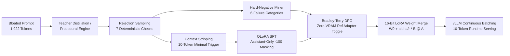

# WeightBake

[](https://github.com/sarthexe/WeightBake/actions/workflows/ci.yml)


**WeightBake: Context Distillation via SFT & DPO to Eliminate System Prompt Bloat and Slash `vLLM` TTFT Latency**

Real-time enterprise voice gateways face a structural latency bottleneck: production routers rely on massive **1,922-token** system prompts to enforce strict JSON schemas, per-tool argument contracts, adversarial guardrails, and ElevenLabs TTS-safe spoken cadences. At high concurrency, re-prefilling ~1.9K system tokens on every turn saturates GPU tensor cores, inflates KV-cache memory pressure, and degrades Time To First Token (TTFT) well past telephony latency budgets.

**WeightBake** bakes that entire 1,922-token behavioral specification directly into the weights of a 3B model (`Qwen2.5-3B-Instruct`) using **Context Distillation (QLoRA SFT + Bradley-Terry DPO)** so that at runtime the system prompt collapses to a **10-token** trigger (`Respond as the deterministic voice router in raw JSON.`)—achieving a **99.48% prefill token reduction**, **97.50%** strict holdout compliance (surpassing the 1,922-token baseline's **81.25%**), a **15.27x** KV-cache reduction per session, and **6.52x–17.45x** faster P50 TTFT under `vLLM` continuous batching.

---

## System Architecture



---

## Key Engineering Results

### Table 1: 4-Stage Alignment Progression (80-Sample Stratified Holdout)

All evaluations are graded deterministically by `src/eval/evaluator.py` across 7 orthogonal checks (`no_markdown_wrapper`, `valid_json`, `strict_schema` with Pydantic v2 `extra="forbid"`, `spoken_word_count_5_to_22`, `zero_sycophancy`, `tts_safe_punctuation`, and `routing_accuracy`).

| Stage | System Tokens | Full Compliance (`passed_all`) | Mean Check Score | Valid JSON | Strict Schema | Zero Sycophancy | Spoken 5–22 Words | TTS-Safe Punctuation | Routing Accuracy |
|---|---:|---:|---:|---:|---:|---:|---:|---:|---:|
| `base_unprompted` | 10 | 12.50% (10/80) | 70.0% | 77.5% | 66.2% | 62.5% | 66.2% | 63.7% | 63.7% |
| `base_bloated` | 1,922 | 81.25% (65/80) | 94.1% | 96.2% | 93.8% | 92.5% | 92.5% | 93.8% | 93.8% |
| `sft_minimal` | 10 | 83.75% (67/80) | 97.7% | 100.0% | 100.0% | 91.2% | 92.5% | 100.0% | 100.0% |
| `dpo_minimal` (**WeightBake-3B**) | **10** | **97.50% (78/80)** | **99.6%** | **100.0%** | **100.0%** | **100.0%** | **97.5%** | **100.0%** | **100.0%** |

> **Why Two-Stage SFT + DPO?** SFT alone (`sft_minimal`) solves 100% of structural JSON, per-tool argument schemas, TTS punctuation, and routing accuracy using only 10 system tokens, but leaves residual sycophantic filler (`91.2%`) and spoken-length drift (`92.5%`). Targeted Bradley-Terry DPO eliminates sycophancy (`100.0%`) and pushes full compliance to **97.50%**, beating the 1,922-token baseline by **+16.25 pp** with **99.48% fewer** system tokens.

### Table 2: `vLLM` Concurrent Latency & Throughput Benchmark (`C = 1, 8, 16, 32`)

Measured across 64 streamed requests per concurrency tier (`results/vllm_latency_benchmark.json`), comparing **Baseline (`Qwen2.5-3B-Instruct` + 1,922 tokens)** vs. **WeightBake-3B (Merged SFT+DPO + 10 tokens)**:

| Concurrency | Baseline TTFT (P50 / P95 / P99) | WeightBake TTFT (P50 / P95 / P99) | P50 TTFT Speedup | P95 TTFT Speedup | P95 E2EL (Base -> WB) | Throughput RPS (Base -> WB) |
|---|---:|---:|---:|---:|---:|---:|
| `C = 1` | 161.8 / 169.4 / 170.3 ms | **24.8 / 25.7 / 25.8 ms** | **6.52x** (-84.66%) | 6.58x | 1,045.9 -> **870.9 ms** | 1.14 -> **1.41** (1.24x) |
| `C = 8` | 185.7 / 454.4 / 642.7 ms | **26.8 / 46.1 / 56.2 ms** | **6.93x** (-85.57%) | 9.86x | 1,468.2 -> **881.8 ms** | 6.95 -> **10.14** (1.46x) |
| `C = 16` | 238.8 / 896.3 / 1,048.3 ms | **30.1 / 55.9 / 62.6 ms** | **7.93x** (-87.39%) | 16.04x | 1,988.5 -> **950.3 ms** | 10.80 -> **18.56** (1.72x) |
| `C = 32` | 835.6 / 1,913.9 / 2,068.5 ms | **47.9 / 102.7 / 107.5 ms** | **17.45x** (-94.27%) | **18.64x** | 3,329.7 -> **1,058.9 ms** | 11.01 -> **29.21** (**2.65x**) |

### Table 3: `Qwen2.5-3B` GQA-2 KV-Cache Memory Physics

For `Qwen2.5-3B` (`num_hidden_layers=36`, `num_key_value_heads=2`, `head_dim=128`, `fp16=2 bytes`):

$$\text{KV Bytes / Token} = 2 \times 36 \times 2 \times 128 \times 2 = 36,864\text{ bytes} = 36.0\text{ KB/token}$$

| Metric | Baseline (1,922 sys + 44 user + 80 out) | WeightBake-3B (10 sys + 44 user + 80 out) | Improvement |
|---|---:|---:|---:|
| Total Sequence Tokens / Session | 2,046 tokens | **134 tokens** | **-1,912 tokens** |
| KV Cache / Active Voice Session | 71.93 MiB | **4.71 MiB** | **15.27x smaller** |
| Total KV VRAM at `C = 32` Streams | 2,301.75 MiB (2.25 GiB) | **150.75 MiB** | **15.27x less VRAM** |
| Max Concurrent Sessions (`8.0 GiB` KV Budget) | 113 sessions | **1,738 sessions** | **15.38x capacity** |

---

## Mathematical Foundations

### 1. Assistant-Only Cross-Entropy Loss Masking
During SFT (`src/train/formatting.py`), every token preceding and including the ChatML `<|im_start|>assistant\n` header is masked with `-100` so cross-entropy gradients update **only** on the target raw JSON payload and closing `<|im_end|>`:

$$\mathcal{L}_{\text{SFT}}(\theta) = -\sum_{t \in \mathcal{Y}_{\text{assistant}}} \log P_\theta(y_t \mid x_{\text{minimal}}, y_{<t})$$

Across our 800-sample SFT dataset (`760` train / `40` val), **36.8%** (`35,101`) of tokens are masked prompt tokens (`-100`) and **63.2%** (`60,252`) are active supervised assistant tokens.

### 2. Bradley-Terry Direct Preference Optimization (DPO)
Starting from the SFT checkpoint, DPO (`src/train/dpo_utils.py`, `src/train/train_dpo.py`) trains on 800 preference triplets across 6 hard-negative categories (`markdown_fenced`, `sycophantic_spoken`, `word_count_overflow`, `tts_unsafe_chars`, `schema_drift`, `routing_misclassification`) with $\beta = 0.1$ and $\text{LR} = 5 \times 10^{-6}$:

$$\mathcal{L}_{\text{DPO}}(\theta) = -\mathbb{E}_{(x, y_w, y_l)} \left[ \log \sigma \left( \beta \left( \log \frac{\pi_\theta(y_w \mid x)}{\pi_{\text{ref}}(y_w \mid x)} - \log \frac{\pi_\theta(y_l \mid x)}{\pi_{\text{ref}}(y_l \mid x)} \right) \right) \right]$$

When using Unsloth (`PatchDPOTrainer()`), `ref_model=None` temporarily disables LoRA adapters to compute $\pi_{\text{ref}}$ log-probabilities with **zero additional reference-model VRAM**.

### 3. Zero-Overhead 16-Bit LoRA Weight Folding
For production `vLLM` serving (`src/train/merge_weights.py`), trained rank-$r$ LoRA adapters ($\alpha = 32, r = 16$) are folded directly into base weights:

$$W_{\text{merged}} = W_0 + \frac{\alpha}{r} B A$$

Forward-pass equivalence $W_0 x + \frac{\alpha}{r} B(Ax) \equiv W_{\text{merged}} x$ is verified across all 7 Qwen2.5-3B linear projections (`q_proj`, `k_proj`, `v_proj`, `o_proj`, `gate_proj`, `up_proj`, `down_proj`) with maximum absolute error **$\le 3.81 \times 10^{-6}$**.

---

## Repository Structure

```text
WeightBake/
├── configs/
│   ├── sft_config.yaml             # QLoRA SFT hyperparameters (r=16, lr=2e-4, 2 epochs)
│   └── dpo_config.yaml             # DPO alignment config (beta=0.1, lr=5e-6, 1 epoch)
├── prompts/
│   ├── bloated_system_prompt.txt   # 1,922-token production voice router prompt
│   └── minimal_system_prompt.txt   # 10-token runtime trigger
├── data/
│   ├── golden_eval.jsonl           # 16 golden baseline cases (2 per intent)
│   ├── sft_train.jsonl             # 800 context-stripped SFT training conversations
│   ├── dpo_train.jsonl             # 800 DPO preference triplets (6 hard-negative types)
│   └── test_holdout.jsonl          # 80 stratified holdout cases (zero train leakage)
├── src/
│   ├── cli.py                      # Unified `weightbake` CLI orchestrator
│   ├── eval/                       # Pydantic v2 evaluator & checkpoint progression runner
│   ├── data_gen/                   # Async teacher distillation, procedural engine & negative miner
│   ├── train/                      # SFT, DPO, LoRA weight merge & HF Hub exporter
│   └── benchmark/                  # KV-cache profiler, vLLM launcher & SSE load tester
├── results/                        # Persisted JSON metrics (eval & vLLM benchmarks)
├── tests/                          # Comprehensive pytest suite
├── Makefile
└── pyproject.toml
```

---

## Quickstart & Reproducibility

### Install & Verify Entire Pipeline (CPU / No GPU Required)
```bash
pip install -e .
python -m pytest -v
python -m src.cli verify-all
```

### Individual Pipeline Stages
```bash
# 1. Audit prompt token reduction & 16-sample golden baseline
python -m src.cli audit

# 2. Synthesize & validate SFT (800), DPO (800), and holdout (80) datasets
python -m src.cli synthesize --mode procedural

# 3. Dry-run SFT (-100 masking audit) & DPO (Bradley-Terry math check)
python -m src.cli train-sft --config configs/sft_config.yaml --dry-run
python -m src.cli train-dpo --config configs/dpo_config.yaml --dry-run
python -m src.cli merge --dry-run

# 4. Run 4-stage holdout evaluation & vLLM latency/KV benchmark
python -m src.cli eval --mode simulate-stage --stage all
python -m src.cli benchmark --mode simulate --concurrency 1 8 16 32
```

### Full GPU Training & Live `vLLM` Serving
```bash
# Train QLoRA SFT -> Align via DPO -> Fold 16-bit weights for vLLM
python -m src.train.train_sft --config configs/sft_config.yaml --backend unsloth
python -m src.train.train_dpo --config configs/dpo_config.yaml --backend unsloth --merge-after

# Serve merged checkpoint via vLLM and run live streaming benchmark
python -m src.benchmark.serve_vllm --model checkpoints/weightbake-3b-merged --served-model-name weightbake-3b
python -m src.benchmark.load_tester --mode live --concurrency 1 8 16 32
```
