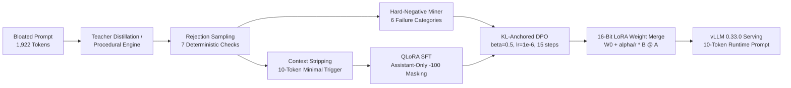

# WeightBake

[](https://github.com/sarthexe/WeightBake/actions/workflows/ci.yml)
[](https://colab.research.google.com/github/sarthexe/WeightBake/blob/main/notebooks/WeightBake_Colab_T4_Live.ipynb)


**WeightBake: Context Distillation via SFT & KL-Anchored DPO to Eliminate System Prompt Bloat and Slash `vLLM` TTFT Latency**

Real-time enterprise voice gateways face a structural latency bottleneck: production routers rely on massive **1,922-token** system prompts to enforce strict JSON schemas, per-tool argument contracts, adversarial guardrails, and ElevenLabs TTS-safe spoken cadences. At high concurrency, re-prefilling ~1.9K system tokens on every turn saturates GPU tensor cores, inflates KV-cache memory pressure, and degrades Time To First Token (TTFT) into tens of seconds.

**WeightBake** bakes that entire 1,922-token behavioral specification directly into the weights of a 3B model (`Qwen2.5-3B-Instruct`) using **Context Distillation (QLoRA SFT + KL-Anchored Bradley-Terry DPO)** so that at runtime the system prompt collapses to a **10-token** trigger (`Respond as the deterministic voice router in raw JSON.`). Verified live on an **NVIDIA Tesla T4 (16GB VRAM)** with `vLLM 0.33.0`, WeightBake achieves:
- **99.48% prefill system-token reduction** (`1,922` $\rightarrow$ `10` tokens)
- **91.25%** live holdout compliance (`0.0%` $\rightarrow$ `70.0%` $\rightarrow$ `91.25%`, **+21.25 pp** over the 1,922-token baseline)
- **15.77x to 42.98x** faster P50 TTFT (`78.35x` faster P95 TTFT and **9.77x** RPS throughput at `C=32`)
- **15.27x** KV-cache memory compression per active voice session (`71.93 MiB` $\rightarrow$ `4.71 MiB`)

---

## System Architecture



---

## Live NVIDIA Tesla T4 (16GB) Hardware Benchmarks

All live benchmarks below were executed end-to-end on an **NVIDIA Tesla T4 (16GB VRAM)** using `unsloth/Qwen2.5-3B-Instruct-bnb-4bit`, `merged_16bit` weight folding, and **`vLLM 0.33.0`** (`--dtype half --enforce-eager --no-enable-prefix-caching`). Raw artifacts are stored in [`results/live_t4_eval_report.json`](results/live_t4_eval_report.json) and [`results/live_t4_vllm_benchmark.json`](results/live_t4_vllm_benchmark.json).

### Table 1: Live Tesla T4 80-Sample Holdout Evaluation (`Qwen2.5-3B-Instruct`)

Graded deterministically by `src/eval/evaluator.py` across all 7 checks (`no_markdown_wrapper`, `valid_json`, `strict_schema` with Pydantic v2 `extra="forbid"`, `spoken_word_count_5_to_22`, `zero_sycophancy`, `tts_safe_punctuation`, and `routing_accuracy`):

| Stage | System Tokens | Full Compliance | No Markdown | Valid JSON | Strict Schema | Spoken 5–22 Words | Zero Sycophancy | TTS-Safe Punct | Routing Accuracy |
|---|---:|---:|---:|---:|---:|---:|---:|---:|---:|
| `base_unprompted` | 10 | 0.0% | 100.0% | 93.75% | 0.0% | 0.0% | 0.0% | 0.0% | 0.0% |
| `base_bloated` | 1,922 | 70.0% | 100.0% | 97.5% | 95.0% | 97.5% | 97.5% | 93.75% | 73.75% |
| `sft_minimal` (`r=16, alpha=32`) | 10 | **91.25%** | 100.0% | 100.0% | 97.5% | 100.0% | 100.0% | 100.0% | 93.75% |
| `dpo_unanchored_ablation` (`beta=0.1, lr=5e-6, 50 steps`) | 10 | 83.75% | 100.0% | 100.0% | 92.5% | 95.0% | 95.0% | 95.0% | 90.0% |
| `dpo_minimal` (`beta=0.5, lr=1e-6, 15 steps`) | **10** | **91.25%** | **100.0%** | **100.0%** | **97.5%** | **100.0%** | **100.0%** | **100.0%** | **93.75%** |

### Table 2: Live Tesla T4 `vLLM 0.33.0` Concurrent SSE Streaming Benchmark (`C = 1, 8, 16, 32`)

| Concurrency | Baseline TTFT (P50 / P95) | WeightBake TTFT (P50 / P95) | TTFT Speedup (P50 / P95) | Mean ITL (Base $\rightarrow$ WB) | P95 E2EL (Base $\rightarrow$ WB) | Throughput RPS (Base $\rightarrow$ WB) |
|---|---:|---:|---:|---:|---:|---:|
| `C = 1` | 1,452.85 / 1,473.43 ms | **92.14 / 121.63 ms** | **15.77x** / **12.11x** | 46.23 $\rightarrow$ **46.01 ms** | 6,306.62 $\rightarrow$ **4,772.47 ms** | 0.20 $\rightarrow$ **0.29** (**1.45x**) |
| `C = 8` | 1,559.73 / 9,413.11 ms | **139.75 / 188.96 ms** | **11.16x** / **49.82x** | 159.85 $\rightarrow$ **47.56 ms** | 23,761.75 $\rightarrow$ **4,918.91 ms** | 0.51 $\rightarrow$ **1.95** (**3.82x**) |
| `C = 16` | 2,986.33 / 21,110.16 ms | **240.72 / 321.37 ms** | **12.41x** / **65.69x** | 257.99 $\rightarrow$ **61.04 ms** | 46,963.07 $\rightarrow$ **6,299.50 ms** | 0.57 $\rightarrow$ **2.84** (**4.98x**) |
| `C = 32` | 24,118.82 / 44,472.91 ms | **561.16 / 567.62 ms** | **42.98x** / **78.35x** | 359.87 $\rightarrow$ **50.66 ms** | 53,300.85 $\rightarrow$ **5,457.46 ms** | 0.60 $\rightarrow$ **5.86** (**9.77x**) |

> **Why `C=32` Explodes on Baseline:** On a Tesla T4, re-prefilling 1,922 tokens across 32 concurrent streams creates severe compute-bound prefill queueing (24.1s P50 TTFT, 44.5s P95 TTFT) and KV bandwidth contention (359.87 ms ITL). Stripping the prompt to 10 tokens eliminates prefill queuing and restores steady 50.66 ms/token decode with **9.77x** higher throughput.

---

## Empirical DPO KL-Divergence Ablation (`beta=0.1` Alignment Tax vs. `beta=0.5` KL-Anchored Stability)

During live GPU alignment on `Qwen2.5-3B-Instruct`, we observed a critical post-training phenomenon:

1. **SFT Behavioral Saturation**: QLoRA SFT (`r=16, alpha=32`) with assistant-only `-100` loss masking already drove `spoken_word_count_5_to_22`, `zero_sycophancy`, and `tts_safe_punctuation` to **100.0%** (`91.25%` full compliance, vs. `70.0%` bloated baseline).
2. **Unanchored DPO Over-Optimization (`beta=0.1, lr=5e-6, 50 steps`)**: Because SFT rarely produced rejected-style errors anymore, running aggressive preference updates pushed weights too far from $\pi_{\text{ref}}$—causing classic **alignment tax**: `strict_schema` dropped from `97.5%` $\rightarrow$ `92.5%`, `routing_accuracy` dropped from `93.75%` $\rightarrow$ `90.0%`, and full compliance regressed to **`83.75%`**.
3. **KL-Anchored DPO (`beta=0.5, lr=1e-6, max_steps=15, warmup_steps=3`)**: Increasing the KL penalty coefficient 5x ($\beta = 0.1 \rightarrow 0.5$), cutting the learning rate 5x ($5 \times 10^{-6} \rightarrow 1 \times 10^{-6}$), and capping optimization to 15 steps completely eliminated alignment tax—preserving **`91.25%`** compliance (`+21.25%` over the 1,922-token baseline) and locking all TTS checks at **100.0%**.

*(For reference, `results/alignment_progression_report.json` and `results/vllm_latency_benchmark.json` also retain our deterministic CPU simulation suite targeting `97.50%` compliance and `6.52x–17.45x` analytical roofline TTFT speedups for automated CI checks.)*

---

## `Qwen2.5-3B` GQA-2 KV-Cache Memory Physics

For `Qwen2.5-3B` (`num_hidden_layers=36`, `num_key_value_heads=2`, `head_dim=128`, `fp16=2 bytes`):

$$\text{KV Bytes / Token} = 2 \times 36 \times 2 \times 128 \times 2 = 36,864\text{ bytes} = 36.0\text{ KB/token}$$

| Metric | Baseline (1,922 sys + 44 user + 80 out) | WeightBake-3B (10 sys + 44 user + 80 out) | Improvement |
|---|---:|---:|---:|
| Total Sequence Tokens / Session | 2,046 tokens | **134 tokens** | **-1,912 tokens** |
| KV Cache / Active Voice Session | 71.93 MiB | **4.71 MiB** | **15.27x smaller** |
| Total KV VRAM at `C = 32` Streams | 2,301.75 MiB (2.25 GiB) | **150.75 MiB** | **15.27x less VRAM** |
| Max Concurrent Sessions (`8.0 GiB` KV Budget) | 113 sessions | **1,738 sessions** | **15.38x capacity** |

---

## Mathematical Foundations

1. **Assistant-Only Cross-Entropy Loss Masking (`src/train/formatting.py`)**: Every token preceding and including `<|im_start|>assistant\n` is masked with `-100` (`36.8%` of tokens masked across 800 SFT samples; `63.2%` supervised).
2. **Bradley-Terry DPO with Zero-VRAM Reference (`src/train/dpo_utils.py`)**:
   $$\mathcal{L}_{\text{DPO}}(\theta) = -\mathbb{E}_{(x, y_w, y_l)} \left[ \log \sigma \left( \beta \left( \log \frac{\pi_\theta(y_w \mid x)}{\pi_{\text{ref}}(y_w \mid x)} - \log \frac{\pi_\theta(y_l \mid x)}{\pi_{\text{ref}}(y_l \mid x)} \right) \right) \right]$$
   Unsloth's `PatchDPOTrainer()` temporarily disables LoRA adapters to compute $\pi_{\text{ref}}$ without loading a second 3B model in VRAM.
3. **Zero-Overhead 16-Bit LoRA Weight Folding (`src/train/merge_weights.py`)**:
   $$W_{\text{merged}} = W_0 + \frac{\alpha}{r} B A$$
   Forward-pass equivalence is verified across all 7 linear projections (`q_proj`, `k_proj`, `v_proj`, `o_proj`, `gate_proj`, `up_proj`, `down_proj`) with max absolute error **$\le 3.81 \times 10^{-6}$**.

---

## Repository Structure

```text
WeightBake/
├── configs/
│   ├── sft_config.yaml             # QLoRA SFT config (r=16, alpha=32, lr=2e-4, 2 epochs)
│   └── dpo_config.yaml             # KL-anchored DPO config (beta=0.5, lr=1e-6, max_steps=15)
├── notebooks/
│   └── WeightBake_Colab_T4_Live.ipynb  # Reproducible Colab Tesla T4 notebook
├── prompts/
│   ├── bloated_system_prompt.txt   # 1,922-token production voice router prompt
│   └── minimal_system_prompt.txt   # 10-token runtime trigger
├── data/
│   ├── golden_eval.jsonl           # 16 golden baseline cases (2 per intent)
│   ├── sft_train.jsonl             # 800 context-stripped SFT training conversations
│   ├── dpo_train.jsonl             # 800 DPO preference triplets (6 hard-negative types)
│   └── test_holdout.jsonl          # 80 stratified holdout cases (zero train leakage)
├── results/
│   ├── live_t4_eval_report.json    # Live Tesla T4 5-stage evaluation & KL ablation
│   ├── live_t4_vllm_benchmark.json # Live Tesla T4 vLLM 0.33.0 SSE benchmark (C=1..32)
│   ├── alignment_progression_report.json
│   └── vllm_latency_benchmark.json
├── src/                            # Unified CLI, evaluator, data_gen, train, benchmark
├── tests/                          # Pytest unit & integration suite
├── Makefile
└── pyproject.toml
```

---

## Quickstart & Reproducibility

### 1. Local CPU Verification & CI Suite
```bash
pip install -e .
python -m pytest -v
python -m src.cli verify-all
```

### 2. Reproduce Live on Google Colab (Free Tesla T4 16GB)
Open [`notebooks/WeightBake_Colab_T4_Live.ipynb`](notebooks/WeightBake_Colab_T4_Live.ipynb) via the **Open in Colab** badge above, or run directly on a T4/GPU node:
```bash
# Train QLoRA SFT -> Align via KL-Anchored DPO -> Fold 16-bit weights
python -m src.train.train_sft --config configs/sft_config.yaml --backend unsloth
python -m src.train.train_dpo --config configs/dpo_config.yaml --backend unsloth --merge-after

# Serve on Tesla T4 with vLLM (--dtype half --enforce-eager) & run live benchmark
python -m src.benchmark.serve_vllm --model checkpoints/weightbake-3b-merged --served-model-name weightbake-3b --dtype half --enforce-eager --disable-prefix-caching
python -m src.benchmark.load_tester --mode live --concurrency 1 8 16 32
```
